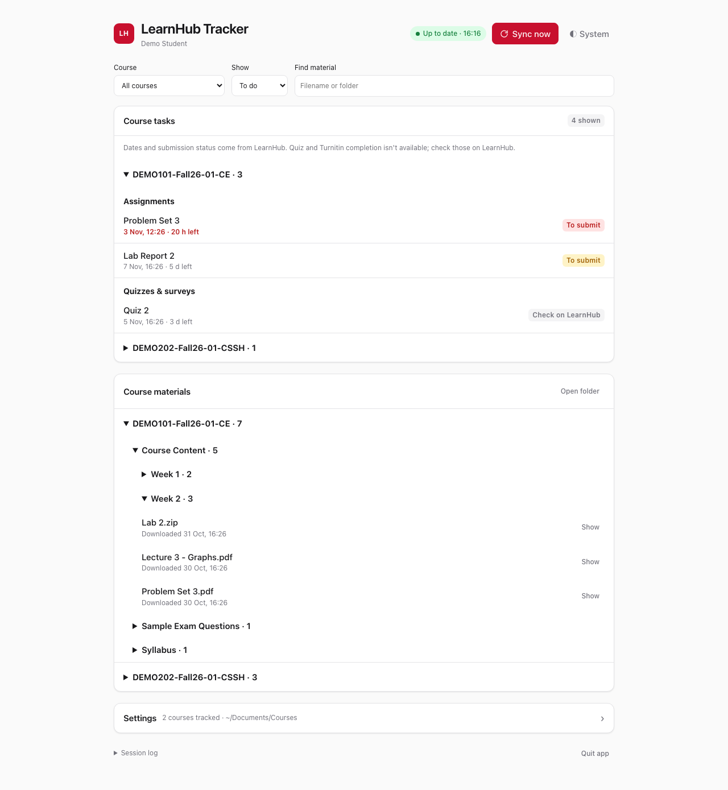

# LearnHub Tracker

Downloads the files of your Koç University LearnHub courses and keeps track of your assignments, on macOS and Windows.



- **Files:** new files of the courses you pick are downloaded into a `Courses` folder, one folder per course, with the same sections as on LearnHub. In the app they appear as folders you open and close, searchable by name. PDFs open in the browser; **Show** reveals a file in Finder/Explorer.
- **Assignments:** each course lists its assignments with their LearnHub submission status, plus quizzes and surveys. Overdue work stays visible and deadlines within 48 hours are highlighted. On a Mac you also get a notification for new assignments and for unsubmitted deadlines within 48 hours.
- **Safe:** it only reads from LearnHub (5 read-only functions), never changes or submits anything, and never overwrites a file on your computer. Your password is typed only into the KU login page.

## Requirements

- macOS or Windows
- Google Chrome (used for the KU NetID login)
- Windows only: Python 3.9 or newer from [python.org](https://www.python.org/downloads/windows/), installed with **Add Python to PATH** checked

## Getting started

1. On this page click **Code → Download ZIP**, then unpack the ZIP. Move the folder wherever you like (for example to Documents).
2. Start the app:
   - **Mac:** double-click **`Start.command`**. If macOS says it cannot verify the file, open **System Settings → Privacy & Security**, click **Open Anyway** next to `Start.command`, then double-click it again (needed only once). If macOS offers to install developer tools, accept, then double-click `Start.command` again.
   - **Windows:** double-click **`Start-Windows.cmd`**.

   The first start installs what it needs (about a minute).
3. The app opens in your browser. Click **Log in with KU NetID** and log in in the Chrome window that opens; it closes by itself.
4. Check the courses you want to track and click **Save selection**. Choose where to save files; a `Courses` folder is created there (Cancel uses `Documents/Courses`). Downloading starts.

## Daily use

Start the app the same way. Keep the terminal window it opens running (you can minimize it): while it runs, LearnHub is checked every 3 hours. **Sync now** checks right away. Starting it again while it runs just reopens the page. To stop, click **Quit app** on the page or close the terminal window.

- **Show:** *To do* lists what is still open, *Submitted* what LearnHub has as submitted, *All tasks* both. Courses with nothing to show are hidden.
- Quiz, survey and Turnitin completion is not available from LearnHub; those show **Check on LearnHub** and leave *To do* after their deadline.
- Files you delete are downloaded again on the next sync. When an instructor updates a file, the new version is saved with its date in the name and the old one is kept.
- **Settings** has the course selection, the download folder (**Change**) and **Sync coverage**: when the last full check succeeded, how many files of each course are on disk, and anything that could not be downloaded.
- Forum posts, external tools and quiz contents are not covered; check [LearnHub](https://learn.hub.ku.edu.tr/) for those.

## Using the terminal instead

Needs Python 3.9 or newer (`python3 --version`) and Google Chrome.

Setup, once:

```bash
git clone https://github.com/kikizoglu23/KU-LearnHub-Tracker.git
cd KU-LearnHub-Tracker
python3 -m venv .venv
.venv/bin/python -m pip install --upgrade pip
.venv/bin/python -m pip install -r requirements.txt
```

Start the app (same browser UI as `Start.command`; stop with Ctrl+C):

```bash
.venv/bin/python app.py
```

Or skip the browser UI entirely:

```bash
.venv/bin/python learnhub.py login     # log in with KU NetID in the Chrome window that opens
.venv/bin/python learnhub.py courses   # answer y/n for each course to track
.venv/bin/python learnhub.py sync      # download new files and check assignments, once
```

On Windows use `python` instead of `python3` and `.venv\Scripts\python.exe` instead of `.venv/bin/python`.

- `sync` runs once and exits; there is no automatic 3-hour check without `app.py`.
- Without the UI, files go to `~/Documents/Courses`. To use another folder, change `download_dir` in `config.json` in the app data folder (see below), or use **Settings → Change** in the UI.
- To update: `git pull`, then install `requirements.txt` again.

## Privacy

- The app runs only on your computer at `127.0.0.1:47653`. The page address carries a secret key that is new on every start, so only the page the app opens can talk to it.
- Settings, download history and the login token are kept in the app data folder:
  - Mac: `~/Library/Application Support/Course_Tracking_System/` (the token file is readable only by your user)
  - Windows: `%LOCALAPPDATA%\LearnHubTracker\` (the token is encrypted for your Windows user)
- The login token never reaches the browser page.

## For developers

- `learnhub.py`: LearnHub client (only 5 allowed read functions, see `READ_ONLY`), file sync, assignments and quizzes, notifications, command line.
- `app.py` + `ui.html`: local server and browser UI; no build step or framework.
- `study_tasks.py`: task list (assignments with submission status, quizzes, Turnitin).
- `resource_library.py`: downloaded file list and serving files that are in the download history.
- `sync_coverage.py`: per-course check results for **Sync coverage**.
- `windows_support.py`: Windows token encryption (DPAPI).
- `Start.command` / `Start-Windows.cmd`: create `.venv`, install `requirements.txt` when it changes, run `app.py`.
- Tests: `python run_tests.py` (fake course data and temporary files, never a real KU session). GitHub Actions runs them on macOS and Windows with Python 3.9 and 3.13.

Created by [Kerem İkizoğlu](https://github.com/kikizoglu23). Windows support, the task list and sync coverage were contributed by [Ahmet Salih Çiçek](https://github.com/A-Salih16).
